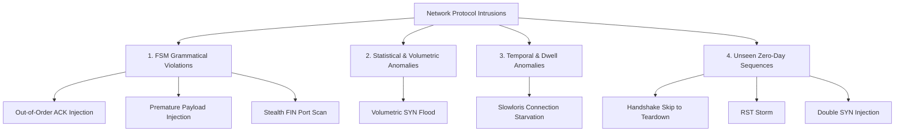

# Phase 2: Synthetic Protocol Dataset & Attack Simulation Pipeline

## 1. Overview & Objectives

In accordance with the project objectives:
- *Select a protocol or use a synthetic protocol-event dataset.*
- *Extract features from event sequences, message types, and transition histories.*
- *Evaluate generalization to previously unseen event sequences.*

Phase 2 establishes a high-fidelity synthetic network traffic generator that produces protocol event sequences combining benign communication with 5 distinct known attack vectors and 3 novel "zero-day" attack variants.

---

## 2. Dataset Schema

Every protocol event is captured with standard networking attributes:

| Column Name | Data Type | Description | Example |
| :--- | :--- | :--- | :--- |
| `session_id` | String | Unique identifier grouping packets of a single flow | `norm_0042`, `atk_syn_3f1a` |
| `seq_index` | Integer | Chronological index within the session | `0, 1, 2, ...` |
| `timestamp` | Float | Epoch timestamp (seconds) | `1729864201.452` |
| `delta_t` | Float | Inter-arrival time from preceding packet ($\Delta t$ in seconds) | `0.0125` |
| `src_ip`, `dst_ip` | String | Source and Destination IP addresses | `192.168.1.15`, `192.168.1.1` |
| `src_port`, `dst_port`| Integer | Source and Destination TCP/UDP ports | `48291`, `8080` |
| `event_type` | String | Protocol message symbol $\sigma \in \Sigma$ | `SYN`, `SYN_ACK`, `ACK`, `DATA`, `FIN`, `RST` |
| `current_state` | String | State $s_t \in Q$ prior to transition | `CLOSED`, `SYN_SENT`, `ESTABLISHED` |
| `next_state` | String | Resulting state $s_{t+1} \in Q$ | `SYN_SENT`, `ESTABLISHED`, `ERROR_STATE` |
| `payload_size` | Integer | Segment byte length | `0`, `512`, `1460` |
| `flags` | String | Pipe-delimited TCP flags | `SYN`, `PSH\|ACK`, `FIN\|ACK` |
| `is_anomaly` | Integer | Ground truth binary label | `0` (Normal), `1` (Anomaly) |
| `attack_category` | String | Ground truth multi-class label | `Normal`, `SYN_Flood`, etc. |
| `violation_type` | String | High-level categorization | `FSM_GRAMMAR_VIOLATION`, `TEMPORAL_DWELL_ANOMALY` |

---

## 3. Attack Taxonomy

The dataset models intrusions spanning multiple vulnerability dimensions:

### Attack Profiles
1. **Out-of-Order ACK Injection (`FSM_GRAMMAR_VIOLATION`)**:
   - An ACK packet arrives while the socket is `CLOSED`.
   - Trapped deterministically by Rule-Based FSM: $\delta(\text{CLOSED}, \text{ACK}) = \emptyset$.
2. **Premature Payload Injection (`FSM_GRAMMAR_VIOLATION`)**:
   - High-volume data transmitted to a closed socket prior to 3-way handshake completion.
3. **Stealth FIN Port Scan (`FSM_GRAMMAR_VIOLATION`)**:
   - Nmap-style unsolicited FIN packet probing firewall status.
4. **Volumetric SYN Flood (`STATISTICAL_FREQUENCY_ANOMALY`)**:
   - Rapid bursts of SYN packets with sub-millisecond $\Delta t$ without completing handshakes.
   - Syntactically valid individually, but statistically anomalous (detected by ML sequence features).
5. **Slowloris Connection Starvation (`TEMPORAL_DWELL_ANOMALY`)**:
   - Syntactically legitimate transitions, but packets are delayed by 20–45 seconds with tiny 1-byte payloads to exhaust server thread pools.
6. **Zero-Day Unseen Sequences (`UNSEEN_TRANSITION_SEQUENCE`)**:
   - Novel combinations used to test model generalization (e.g., Handshake Skip: `SYN` $\to$ `FIN`, `RST` flood).

---

## 4. Generated Dataset Breakdown

The generated datasets are stored in `backend/data/`:

| Dataset File | Total Packets | Sessions | Normal Packets | Anomaly Packets | Primary Purpose |
| :--- | :--- | :--- | :--- | :--- | :--- |
| `train_traffic.csv` | 6,344 | 869 | 5,987 (94.37%) | 357 (5.63%) | Feature extraction & ML model training |
| `test_traffic.csv` | 2,184 | 300 | 2,050 (93.86%) | 134 (6.14%) | Primary benchmark & detector comparison |
| `zero_day_traffic.csv`| 93 | 41 | 8 | 85 | Generalization & zero-day robustness test |
