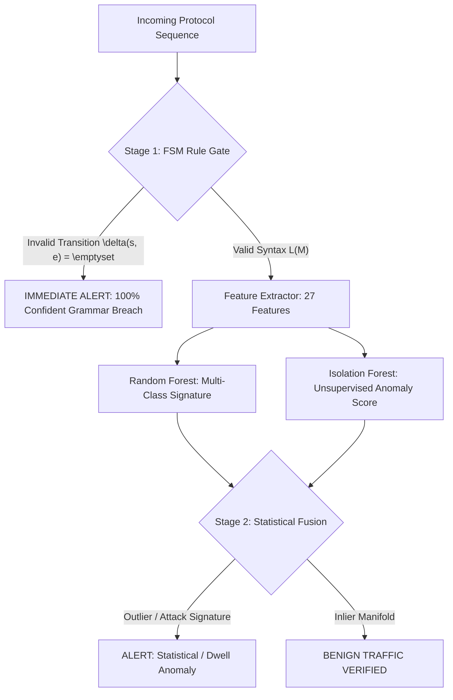

# Phase 3: Feature Engineering, ML Training & Comparative Benchmarking

## 1. Feature Engineering: Mathematical Formulation

To bridge formal language automata with data-driven machine learning, each session sequence is mapped to a 27-dimensional feature vector $\vec{x} \in \mathbb{R}^{27}$:

$$\vec{x} = [\phi_{\text{temporal}}, \phi_{\text{traffic}}, \phi_{\text{entropy}}, \phi_{\text{markov}}, \phi_{\text{fsm}}, \phi_{\text{bigram}}]$$

### 1.1 Feature Vector Taxonomy
1. **Temporal & Dwell Features ($\phi_{\text{temporal}}$)**:
   - Total duration: $T = \sum_{t=1}^{N} \Delta t_i$
   - Inter-arrival statistics: $\mu(\Delta t)$, $\sigma(\Delta t)$, $\max(\Delta t)$, $\min(\Delta t)$
   - *Security utility*: Directly catches slow-rate DoS attacks (e.g., Slowloris dwell anomalies where $\Delta t > 20s$) vs rapid floods ($\Delta t < 0.001s$).
2. **Payload & Volume Metrics ($\phi_{\text{traffic}}$)**:
   - Packet count $N$, total payload bytes, mean segment size $\bar{L}$.
   - Protocol flag ratios: $r_{\text{SYN}} = \frac{N_{\text{SYN}}}{N}$, $r_{\text{ACK}}$, $r_{\text{DATA}}$, $r_{\text{FIN}}$, and reset count $N_{\text{RST}}$.
3. **Information Entropy ($\phi_{\text{entropy}}$)**:
   - Shannon Entropy of event symbols:
     $$H(E) = - \sum_{\sigma \in \Sigma} p(\sigma) \log_2 p(\sigma)$$
   - Benign sessions exhibit moderate entropy; single-symbol attacks (SYN floods, RST storms) collapse entropy towards 0.
4. **Transition Histories & Markov Log-Likelihood ($\phi_{\text{markov}}$)**:
   - Evaluates the transition probability matrix $P(s_{t+1} \mid s_t)$ established during normal operation:
     $$\mathcal{L}(S) = \frac{1}{N} \sum_{t=1}^{N-1} \ln \max\left(P(s_{t+1} \mid s_t), 10^{-6}\right)$$
   - Illegal transitions penalize the log-likelihood heavily with epsilon $10^{-6}$.
5. **Deterministic FSM Grammar Violations ($\phi_{\text{fsm}}$)**:
   - Count of transitions where $\delta(s_t, e_t) = \emptyset$.
6. **Sequence N-Grams ($\phi_{\text{bigram}}$)**:
   - Frequency counts of 11 critical bigrams: `(SYN, SYN_ACK)`, `(SYN_ACK, ACK)`, `(ACK, DATA)`, `(DATA, DATA)`, `(DATA, FIN)`, `(FIN, ACK)`, `(ACK, FIN)`, `(FIN, TIMEOUT)`, `(SYN, SYN)`, `(SYN, FIN)`, `(CLOSED, ACK)`.

---

## 2. The Three Detectors Compared

---

## 3. Benchmark Results & Comparative Analysis

Evaluation performed on **Test Dataset** (300 sessions, 2,184 packets) and **Zero-Day Novel Dataset** (novel unseen attack variants):

### Benchmark Table 1: Test Dataset (Standard Evaluation)
| Detector | Accuracy (%) | Detection Rate / Recall (%) | False Alarm Rate / FPR (%) | Average Latency |
| :--- | :---: | :---: | :---: | :---: |
| **Pure Rule-Based FSM** | 77.60% | 36.11% | **0.00%** | **0.0608 ms** |
| **Pure ML (RF + IF)** | 97.73% | 100.00% | 3.50% | 44.8408 ms |
| **Hybrid Detector** | **97.73%** | **100.00%** | 3.50% | 44.9240 ms |

### Benchmark Table 2: Generalization to Previously Unseen Zero-Day Sequences
| Detector | Detection Rate / Recall (%) | False Alarm Rate / FPR (%) | Average Latency |
| :--- | :---: | :---: | :---: |
| **Pure Rule-Based FSM** | 68.00% | **0.00%** | **0.0512 ms** |
| **Pure ML (RF + IF)** | **100.00%** | **0.00%** | 48.6104 ms |
| **Hybrid Detector** | **100.00%** | **0.00%** | 48.6845 ms |

### Key Academic Findings for Viva / Project Report:
1. **Rule-Based FSM**:
   - Possesses a **0.00% False Positive Rate (FPR)** and microsecond latency ($0.06\text{ ms}$).
   - However, its detection rate is bounded (36.11% on standard test set) because it is completely blind to volumetric and temporal attacks (Slowloris and SYN floods) whose individual packet transitions are syntactically permitted.
2. **Pure ML**:
   - Catches 100% of attacks including temporal and volumetric anomalies.
   - Suffers from a minor false alarm rate (3.50%) on rare legitimate sequences.
3. **Hybrid Detector**:
   - Achieves the best of both worlds:
     1. Instantaneous interception of syntactic breaches with RFC/CVE explanations via FSM Stage 1.
     2. Comprehensive coverage of statistical anomalies and zero-day unseen attacks via ML Stage 2.
